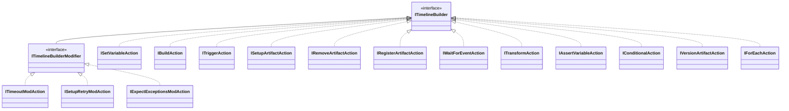
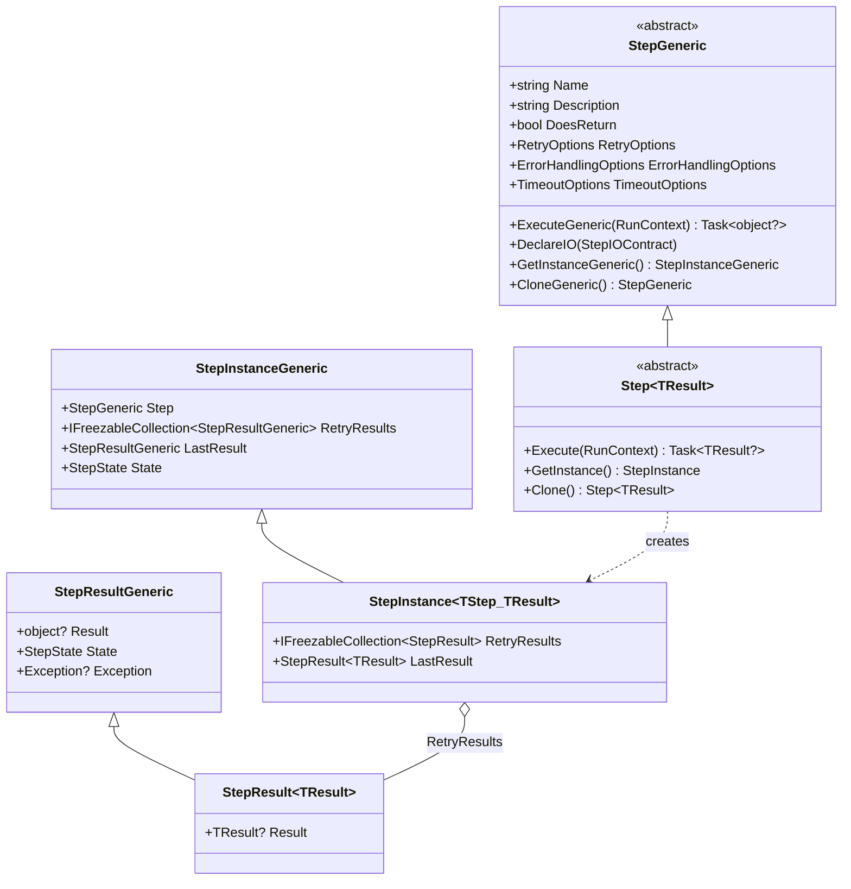
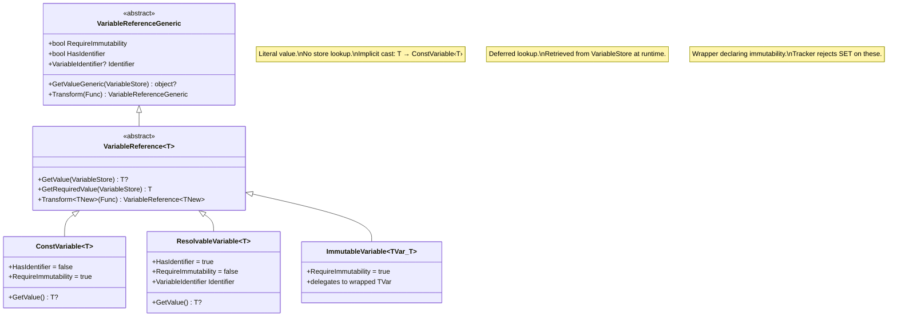
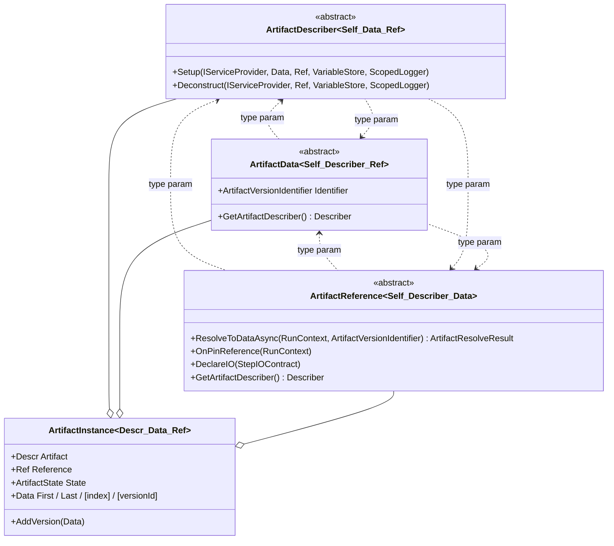
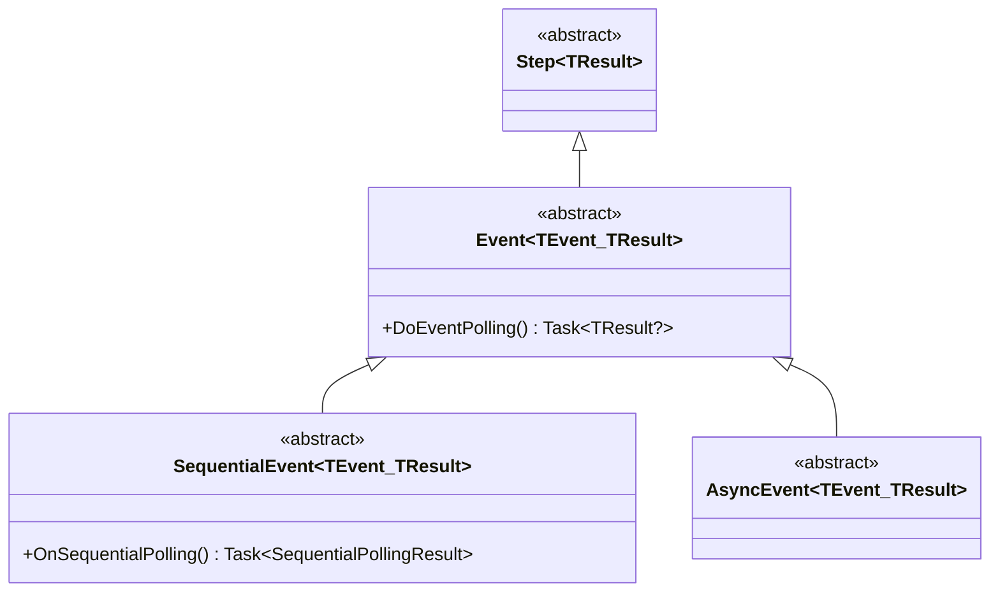

# Core Architecture & Type-Safe API

> **Scope**: This document covers `TestFramework.Core` — the engine that provides the foundational scaffold.  
> Domain-specific logic (Azure, LocalIO, etc.) lives in separate extension projects.  
> For the architecture-decision view of the same system see [Arc42.md](Arc42.md).

---

## Table of Contents

1. [Design Philosophy](#1-design-philosophy)
2. [Freezable Pattern](#2-freezable-pattern)
3. [Timeline Model](#3-timeline-model)
4. [Run / Context Model](#4-run--context-model)
5. [Steps System](#5-steps-system)
6. [Variables System](#6-variables-system)
7. [Artifacts System](#7-artifacts-system)
8. [Events](#8-events)
9. [Extension Points](#9-extension-points)
10. [Minimal Example](#10-minimal-example)
11. [Open Ideas](#11-open-ideas)

---

## 1. Design Philosophy

The Core is an **engine** that only provides a scaffold — concrete behaviours are supplied by extensions.

**Key design principles:**

| Principle | Mechanism |
|-----------|-----------|
| **Compiler-validated types** | Generics with self-referencing constraints (CRTP) prevent type mismatches at compile time. |
| **Immutability after construction** | The [Freezable Pattern](#2-freezable-pattern) locks every object after it enters the execution pipeline. |
| **Separation of Build / Run / Result** | Three distinct phases each with their own types (Builder → Runner → Run). |
| **Extension-driven** | Core defines abstract base classes (`Step<TResult>`, `Event<TEvent, TResult>`, Artifact triple). Extensions implement them. |
| **Variable-referenced configuration** | Step options (`RetryOptions`, `TimeoutOptions`) use `VariableReference<T>` — config values can be resolved at runtime. |

### Lifecycle at a Glance

```mermaid
flowchart LR
    subgraph Build Phase
        A["Timeline.Create()"] --> B["ITimelineBuilder\n(fluent API)"]
        B --> C[".Build()"]
    end
    subgraph Run Phase
        C --> D["timeline.SetupRun()\n→ ITimelineRunBuilder"]
        D --> E[".AddVariable() / .AddArtifact()"]
        E --> F[".RunAsync()"]
    end
    subgraph Execution
        F --> G["Preprocess\n(Emit Steps)"]
        G --> H["Validate\n(IO contracts + immutability)"]
        H --> I["Execute Main Stage"]
        I --> J["Execute Cleanup Stage"]
        J --> K["Freeze → TimelineRun"]
    end
```



---

## 2. Freezable Pattern

Definitions — steps, stages, timelines and their options — implement `IFreezable`. They are frozen when
they are built, and a mutation afterwards throws `FrameworkStateException`.

The contract is [`IFreezable`](../TestFramework.Core/IFreezable.cs): `IsFrozen`, `Freeze()`, and a check that throws once frozen.

**Freezable collections** provide the same guarantee for data structures:

| Type | Description |
|------|-------------|
| `FreezableCollection<T>` | `ICollection<T>` — freezes itself and any `IFreezable` items recursively. |
| `FreezableDictionary<TKey, TValue>` | `IDictionary<TKey, TValue>` — freezes values recursively if they are `IFreezable`. |

**A run is finished, not frozen.** Its live state — variables, artifacts, run state, effective settings,
resource values, environment state and widgets — is not frozen object by object. One
[`RunWriteGate`](../TestFramework.Core/Runner/RunWriteGate.cs) per run decides whether a write still counts:
every write needs a ticket only that gate mints, and `Finish` closes every channel at once when the run's
cleanup has run. That is why `VariableStore` and `ArtifactStore` are not `IFreezable`. A channel added later
cannot be forgotten at the end of the run, because it cannot be written without the gate.

**Why it matters:** After a Timeline is built, its structure is frozen. After a Run completes, its results and
stores are a snapshot of the execution: nothing — not a late write from an abandoned attempt, not a caller
holding the run — can change what it recorded.

---

## 3. Timeline Model

A **Timeline** is a collection of steps organized into two stages.

### 3.1 Timeline Class

[`Timeline`](../TestFramework.Core/Timelines/Timeline.cs) is created with `Timeline.Create()` and built once. It holds one main stage of
emitters; `SetupRun(...)` - with an optional service provider and an optional method that writes the run log -
creates a run builder.

- The main stage holds the steps that perform the test actions.
- The cleanup stage is not part of the timeline: the run builds it, from what the run actually set up, found or
  registered, so a teardown cannot drift from what happened.

### 3.2 PreProcessableStage

Stages store **emitters** (not concrete steps) during build time. Emitters expand into concrete steps when `RunAsync()` preprocesses the timeline.

See [`PreProcessableStage`](../TestFramework.Core/Stages/PreProcessableStage.cs): a name, a description, and the emitters.

### 3.3 Builder: Fluent API

The builder is a composite of **12 action interfaces** + **3 modifier interfaces**:



**Action methods** return `ITimelineBuilderModifier` — so modifiers can be chained directly after:

<!-- snippet: arch-modifiers -->
```csharp
return Timeline.Create()
    .Trigger(myStep)                                   // an action
        .WithRetry(3, i => TimeSpan.FromSeconds(i))    // a modifier on that action
        .WithTimeout(TimeSpan.FromMinutes(5))          // another modifier
    .SetVariable("key", "value")            // the next action
    .Build();
```

**Control-flow actions** (`Conditional`, `ForEach`) return `ITimelineBuilder` (not `ITimelineBuilderModifier`), because they wrap nested sub-builders:

<!-- snippet: arch-control-flow -->
```csharp
return Timeline.Create()
    .Conditional(Var.RefImmutable<bool>("flag"), thenBranch =>
    {
        thenBranch.Trigger(someStep);
        thenBranch.SetVariable("x", 42);
    })
    .ForEach(Var.RefImmutable<string[]>("items"), "item", loop =>
    {
        loop.Trigger(processStep);
    })
    .Build();
```

#### Complete Action Reference

| Action | Signature | Purpose |
|--------|-----------|---------|
| `SetVariable<T>` | `(VariableIdentifier, VariableReference<T>)` | Set a runtime variable |
| `Trigger<TResult>` | `(Step<TResult>)` | Execute a custom step |
| `WaitForEvent<TEvent, TResult>` | `(Event<TEvent, TResult>)` | Wait for an external event |
| `Transform<TFrom, TTo>` | `(VarId, VarRef<TFrom>, Func<TFrom?, TTo>)` | Map one variable to another (sync or async) |
| `AssertVariable<T>` | `(VarRef<T>, Func<T?, bool>)` | Validate variable with predicate |
| `SetupArtifact` | `(ArtifactIdentifier)` | Setup artifact + auto-generate cleanup |
| `RemoveArtifact` | `(ArtifactIdentifier)` | Manually deconstruct an artifact |
| `RegisterArtifact` | `<TRef, TDescr, TData>(ArtifactId, TRef)` | Register externally-created artifact |
| `CaptureArtifactVersion` | `(ArtifactId, VersionId?)` | Snapshot current artifact state |
| `Conditional` | `(condition, Action<ITimelineBuilder>)` | Conditional step emission |
| `ForEach<TItem>` | `(collection, VarId, Action<ITimelineBuilder>)` | Loop emission |
| `Build` | `()` → `Timeline` | Finalize and freeze the timeline |

#### Modifier Reference

| Modifier | Signature | Default |
|----------|-----------|---------|
| `WithTimeout` | `(VariableReference<TimeSpan>)` | 10 minutes |
| `WithRetry` | `(VarRef<int>, CalcDelay)` | 0 retries, exponential backoff |
| `ExpectExceptions` | `(params Type[])` | none |

---

## 4. Run / Context Model

### 4.1 ITimelineRunBuilder — Setting Up a Run

After building a `Timeline`, a run is configured via `ITimelineRunBuilder`:

[`ITimelineRunBuilder`](../TestFramework.Core/Timelines/Builder/TimelineRunBuilder/ITimelineRunBuilder.cs) adds variables, artifacts and
an environment to one run, then `RunAsync()` executes it.

Variables and artifacts registered here become the **external inputs** to the run and are tracked separately from those created during execution.

### 4.2 Execution Lifecycle (RunAsync)

```
RunAsync()
  │
  ├─ 1. PreProcessStages()
  │     ├─ Expand all StepEmitters → concrete Steps
  │     ├─ Apply modifier chains (timeout, retry, exceptions)
  │     └─ Track variable/artifact dependencies
  │
  ├─ 2. IOContractValidator.Validate()
  │     ├─ declared step IO contracts → producer-before-consumer + type compatibility
  │     └─ VariableTracker records      → immutability
  │
  ├─ 3. Execute Main Stage
  │     └─ CoreRunner.RunStage() → sequential step execution with retry
  │
  ├─ 4. Execute Cleanup Stage
  │     └─ CoreRunner.RunStage() → deconstruct artifacts
  │
  └─ 5. Freeze everything → return TimelineRun
```

### 4.3 TimelineRun — Immutable Result

[`TimelineRun`](../TestFramework.Core/Timelines/TimelineRun.cs) holds the timeline, the run's variable and artifact stores, its stages,
the resource values it resolved and the environment it used, and `EnsureRanToCompletion()`.

### 4.4 StageInstance & StageResult

A [`StageInstance`](../TestFramework.Core/Stages/StageInstance.cs) carries its stage, its result (`NotRun`, `Complete`, `Error`) and its step instances.

---

## 5. Steps System

### 5.1 Type Hierarchy



### 5.2 StepGeneric — Abstract Base

Every step inherits from `StepGeneric` (non-generic base for interop) and `Step<TResult>` (typed subclass):

The members a step implements are on [`Step<TStepResultContext>`](../TestFramework.Core/Steps/Step.cs): `Name`, `Description`,
`DoesReturn`, `Execute(RunContext)`, `DeclareIO(StepIOContract)`, `GetInstance()` and `Clone()`. Section 9.1 is a
complete one.

- **`DoesReturn`**: If `true`, the runner records the typed result context on the step result and applies any configured result-property bindings.
- **`Clone()`**: Steps are cloned before execution to preserve the original template.
- **`DeclareIO()`**: Declares what the step reads and writes, so the run can be checked before anything executes.

### 5.3 Step Instance & Result

A `StepInstance` is the runtime representation of a step. It tracks every retry attempt:

States are `NotRun`, `Complete`, `Timeout`, `Error` and `Skipped`; see [`StepResult`](../TestFramework.Core/Steps/StepResult.cs).

Each retry adds a new `StepResult` to `RetryResults`. `LastResult` and `State` are computed from the most recent entry.

### 5.4 Step Options

| Option | Key Properties | Default |
|--------|----------------|---------|
| **RetryOptions** | `VariableReference<int> MaxRetryCount` | 0 |
|  | `VariableReference<CalcDelay> CalcDelay` | `i => TimeSpan.FromSeconds(Math.Pow(2, i))` |
| **TimeoutOptions** | `VariableReference<TimeSpan> Timeout` | `TimeSpan.FromMinutes(10)` |
| **ErrorHandlingOptions** | `IFreezableCollection<Type> IgnoreExceptionTypes` | empty |

`CalcDelay` is a delegate: `delegate TimeSpan CalcDelay(int currentIteration);`

All option values are `VariableReference<T>` — they can be constants or resolvable from the variable store at runtime.

### 5.5 Step Preprocessor (Emitters)

The builder does not store concrete steps. It stores **StepEmitters** that generate steps during preprocessing:

See [`StepEmitter`](../TestFramework.Core/Steps/Preprocessor/StepEmitter.cs).

| Emitter | Behaviour |
|---------|-----------|
| `SingleStepEmitter` | Wraps one step. Clones it, applies modifiers, yields one result. |
| `ConditionalStepEmitter` | Evaluates a `VariableReference<bool>` at preprocess time. Yields nested builder steps if `true`, nothing if `false`. |
| `ForEachStepEmitter<TItem>` | Iterates a collection at preprocess time. For each item, emits a `SetVariableStep` + the nested builder body. |

**Modifier chain**: `.WithTimeout()`, `.WithRetry()`, `.ExpectExceptions()` are stored as modifier callbacks on the last emitter. They are applied when the emitter executes `Emit()`.

### 5.6 System Steps (Built-In)

These are `internal` step implementations used by the builder:

| Step | Generic Params | Purpose |
|------|---------------|---------|
| `SetVariableStep` | — | Sets a variable in the store from a `VariableReferenceGeneric` |
| `TransformStep<TFrom, TTo>` | `TFrom`, `TTo` | Applies an async transformation from one variable to another |
| `SetupArtifactStep` | — | Pins an artifact reference, calls `SetupGeneric()`, marks state as `Setup` |
| `DeconstructArtifactStep` | — | Calls `DeconstructGeneric()`, marks state as `Cleaned` (only if currently `Setup`) |
| `RegisterArtifactStep<TDescr, TData, TRef>` | 3 artifact types | Resolves an external artifact, creates an `ArtifactInstance`, adds to store |
| `CaptureArtifactVersionStep` | — | Resolves artifact to a specific version and adds it to the version history |
| `AssertVariableStep<T>` | `T` | Evaluates a predicate against a variable value, throws `AssertVariableException` if false |

### 5.7 Execution Engine (CoreRunner)

The `CoreRunner` executes a single stage:

```
For each StepInstance in stage:
  │
  ├─ Retry loop (iteration = 1..MaxRetryCount+1)
  │   ├─ If iteration > 1: await CalcDelay(iteration)
  │   ├─ Create CancellationTokenSource(Timeout)
  │   ├─ Execute step
  │   ├─ On success:
  │   │   ├─ State = Complete
    │   │   └─ If DoesReturn: persist the result context and project configured properties into named variables
  │   └─ On exception:
  │       ├─ If type in IgnoreExceptionTypes → State = Complete
  │       └─ Otherwise → State = Error
  │   └─ Freeze StepResult, add to RetryResults
  │
  ├─ If last State != Complete → Stage.Result.State = Error, return
  └─ Freeze StepInstance
```

The stage processes steps **sequentially** — each step completes (including all retries) before the next begins. If any step ultimately fails, the stage is marked `Error` and execution stops.

---

## 6. Variables System

### 6.1 Type Hierarchy



### 6.2 Var Factory

The `Var` static class is the user-facing API for creating variable references:

[`Var`](../TestFramework.Core/Variables/Var.cs): `Var.Const(value)` needs no lookup, `Var.Ref<T>(name)` reads the store when the step runs,
and `Var.RefImmutable<T>(name)` additionally refuses any later write to that name.

**Implicit conversions** make the API ergonomic:

<!-- snippet: arch-conversions -->
```csharp
// string -> VariableIdentifier (implicit)
VariableIdentifier id = "myVar";

// T -> VariableReference<T> (implicit, a constant)
VariableReference<int> five = 5;
```

### 6.3 Transform Chains

Variable references support composable transformations:

<!-- snippet: arch-transforms -->
```csharp
// Single transform - appends to the chain, returns a new reference
VariableReference<string> doubled = Var.Ref<int>("count")
    .Transform(x => x * 2)
    .Transform(x => x.ToString());

// Multi-variable transform - depends on other variables
VariableReference<string> combined = Var.Ref<string>("greeting")
    .Transform((greeting, vars) => greeting + " " + vars[0], Var.Ref<string>("name"));
```

**Const vs Resolvable transform behaviour:**

| | `ConstVariable<T>` | `ResolvableVariable<T>` |
|-|---------------------|-------------------------|
| Single-value `.Transform()` | **Eager** — evaluates immediately, returns new `ConstVariable` | **Lazy** — appends to chain, evaluates on `GetValue()` |
| Multi-variable `.Transform()` | **Lazy** — stores transform + deps | **Lazy** — stores transform + deps |

### 6.4 VariableStore

Runtime storage for variable values:

[`VariableStore`](../TestFramework.Core/Variables/VariableStore.cs) sets and gets values by identifier.

The store holds values as `object?`. Transforms are not applied by the store — they are applied by the `VariableReference` implementations during `GetValue()`.

### 6.5 IOContractValidator — Compile-Time-Like Validation

After preprocessing, `IOContractValidator.Validate()` walks the linearly-ordered main stage steps and
checks their declared `StepIOContract` entries:

1. **Definition order**: every required input must already be produced — by an earlier step's declared
   output, or by a variable/artifact supplied to the run.
2. **Type compatibility**: where both the producing output and the consuming input declare a type, the
   producer's type must be assignable to the consumer's, mirroring `GetVariable<T>()` cast semantics.
3. **Immutability**: a variable read through an `ImmutableVariable` may not be written afterwards.

Declared contracts carry no notion of immutability, so rule 3 comes from a different source: the
`VariableTracker` built during preprocessing, which records reads together with whether the reference
demanded an immutable binding. `PreProcessStages` hands that tracker to `Validate`.

Validation errors:

| Exception | Cause |
|-----------|-------|
| `IOContractViolationException` | A required input has no producer before the consuming step |
| `IOContractTypeViolationException` | Producer and consumer both declare a type and they are incompatible |
| `CannotSetImmutableVariableException` | A variable read through an ImmutableVariable is written later |

`VariableTracker` and `ArtifactTracker` remain part of the public `StepEmitter.Emit` signature so that
emitters can record what they touch, but they no longer validate anything themselves.

---

## 7. Artifacts System

### 7.1 Three-Tier Generic System (CRTP)

Artifacts use a self-referencing generic pattern (Curiously Recurring Template Pattern) to ensure complete type safety across the triple:



The constraint pattern ensures that when you implement one part, the compiler enforces consistency with the other two:

Section 9.2 shows a complete triple.

### 7.2 The Three Components

| Component | Responsibility | Key Methods |
|-----------|---------------|-------------|
| **ArtifactDescriber** | Defines *how* to set up and tear down an artifact kind. Stateless. | `Setup(...)`, `Deconstruct(...)` |
| **ArtifactData** | Carries the artifact's payload in a raw, serializable form (e.g. bytes for a blob, rows for a DB). Supports versioning via `ArtifactVersionIdentifier`. | `GetArtifactDescriber()` |
| **ArtifactReference** | Identifies *which specific* artifact this is. Resolves to data from the external source. Pinnable (freezes variable-derived values). | `ResolveToDataAsync(...)`, `OnPinReference(...)`, `DeclareIO(...)` |

### 7.3 ArtifactInstance — Runtime Tracking

An [`ArtifactInstance`](../TestFramework.Core/Artifacts/ArtifactInstance.cs) holds the describer, the reference, its state
(`NotSetup`, `Setup`, `Cleaned`, `NotFound`) and every version captured during the run.

### 7.4 Artifact Lifecycle

```
  NotSetup
     │
     ├─ SetupArtifactStep ──► Setup
     │                          │
     │                          ├─ CaptureArtifactVersionStep (can repeat)
     │                          │
     │                          └─ DeconstructArtifactStep ──► Cleaned
     │
     └─ RegisterArtifactStep ──► Setup  (if found)
                               ──► NotFound  (if not found)
```

- **Setup** is called with the `ArtifactData` and `ArtifactReference`.
- **Deconstruct** only runs if state is `Setup` — safe to call unconditionally.
- **CaptureArtifactVersion** can be called multiple times to track state evolution.
- **Register** resolves an externally-created artifact into the store.

### 7.5 ArtifactStore & ArtifactTracker

[`ArtifactStore`](../TestFramework.Core/Artifacts/ArtifactStore.cs) holds the run's artifact instances by identifier.

`ArtifactTracker` mirrors `VariableTracker`: it records SET/GET operations during preprocessing. Artifact definition order is validated by `IOContractValidator` from the declared step contracts, not by the tracker.

### 7.6 Identifiers

`ArtifactIdentifier` and `ArtifactVersionIdentifier` convert implicitly from a string.

---

## 8. Events

Events are **steps that poll** for external state changes. They inherit from `Step<TResult>`.



### 8.1 Event Base

[`Event<TEvent, TStepResultContext>`](../TestFramework.Core/Events/Event.cs) is a step whose `Execute` delegates to `DoEventPolling(RunContext)`.

The self-constraining generic (`TEvent : Event<TEvent, TResult>`) ensures type-safe hierarchies.

### 8.2 SequentialEvent — Polling Pattern

[`SequentialEvent`](../TestFramework.Core/Events/SequentialEvent.cs) implements `OnSequentialPolling(RunContext)` and answers
`SequentialPollingResult<T>.Done(result)` or `.NotYet(delay)`.

The polling loop runs until a poll answers `Done`, waiting the delay `NotYet` named between polls. The step's `TimeoutOptions` cancellation token enforces the overall timeout.

### 8.3 AsyncEvent

Marker base class for events that complete asynchronously (e.g., via callbacks). Extensions implement the specific mechanism.

---

## 9. Extension Points

The Core defines abstract types that extensions implement. Here is how to extend each concept:

### 9.1 Custom Step

<!-- snippet: arch-custom-step -->
```csharp
public sealed record MyResult(string Summary) : StepResultContext;

public class MyStep : Step<MyResult>
{
    public override string Name => "My Custom Step";
    public override string Description => "Does something useful";
    public override bool DoesReturn => true;

    public override Task<MyResult?> Execute(RunContext context)
    {
        context.Logger.LogInformation("Executing my step...");

        // Everything the step is given is on the context: the run's stores, how long it has
        // (context.Deadline), and where the run's resources ended up (context.Values).
        return Task.FromResult<MyResult?>(new MyResult("done"));
    }

    public override void DeclareIO(StepIOContract contract)
    {
        // Declare what the step reads and writes, e.g. contract.Input(someVariableReference).
    }

    public override StepInstance<Step<MyResult>, MyResult> GetInstance()
        => new StepInstance<Step<MyResult>, MyResult>(this);

    public override Step<MyResult> Clone()
        => new MyStep().WithClonedOptions(this);
}
```

### 9.2 Custom Artifact Triple

Implement all three types with matching generic constraints:

<!-- snippet: arch-artifact-triple -->
```csharp
// 1. Describer - how to create and destroy one
public sealed class BlobDescriber : ArtifactDescriber<BlobDescriber, BlobData, BlobReference>
{
    public override Task Setup(RunContext context, BlobData data, BlobReference reference)
    {
        // Upload data.Bytes to the pinned container and blob name.
        return Task.CompletedTask;
    }

    public override Task Deconstruct(RunContext context, BlobReference reference)
    {
        // Delete the blob.
        return Task.CompletedTask;
    }

    public override string ToString() => "Blob";
}

// 2. Data - the payload
public sealed class BlobData : ArtifactData<BlobData, BlobDescriber, BlobReference>
{
    public byte[] Bytes { get; init; } = [];

    public override string ToString() => $"{Bytes.Length} bytes";
}

// 3. Reference - which one, and how to read it back
public sealed class BlobReference(VariableReference<string> containerUrl, VariableReference<string> blobName)
    : ArtifactReference<BlobReference, BlobDescriber, BlobData>
{
    public override Task<ArtifactResolveResult<BlobDescriber, BlobData, BlobReference>> ResolveToDataAsync(
        RunContext context, ArtifactVersionIdentifier versionIdentifier)
    {
        // Download the blob, or report it absent.
        return Task.FromResult(new ArtifactResolveResult<BlobDescriber, BlobData, BlobReference>
        {
            Found = true,
            Data = new BlobData(),
        });
    }

    public override void OnPinReference(RunContext context)
    {
        // Resolve variable-referenced fields to the values this run uses.
    }

    public override void DeclareIO(StepIOContract contract)
    {
        contract.Input(containerUrl);
        contract.Input(blobName);
    }

    public override string ToString() => "Blob";
}
```

### 9.3 Custom Event

<!-- snippet: arch-custom-event -->
```csharp
public sealed record QueueMessage(string Body) : StepResultContext;

public class QueueMessageEvent : SequentialEvent<QueueMessageEvent, QueueMessage>
{
    public override string Name => "Wait for Queue Message";
    public override string Description => "Polls a queue until a message arrives";
    public override bool DoesReturn => true;

    public override async Task<SequentialPollingResult<QueueMessage>> OnSequentialPolling(RunContext context)
    {
        string? message = await PollQueueAsync(context);

        return message is not null
            ? SequentialPollingResult<QueueMessage>.Done(new QueueMessage(message))
            : SequentialPollingResult<QueueMessage>.NotYet(TimeSpan.FromSeconds(2));
    }

    // ... Clone(), GetInstance(), DeclareIO() as for any step ...
```

### 9.4 Dependency Injection via IServiceProvider

Steps, events and artifact methods all reach the run's services through `RunContext.Services`. A provider passed to `SetupRun` stays the caller's; one handed over with `RunServices.Owned` is disposed by the run:

<!-- snippet: arch-services -->
```csharp
// The caller keeps a provider it passes; RunServices.Owned hands one to the run, which disposes it.
TimelineRun run = await timeline
    .SetupRun(RunServices.Owned(myServiceCollection.BuildServiceProvider()))
    .AddVariable("key", "value")
    .RunAsync();
```

If no `IServiceProvider` is supplied, an `EmptyServiceProvider` (returns `null` for all requests) is used.

---

## 10. Minimal Example

A complete example demonstrating the core concepts:

<!-- snippet: arch-minimal-example -->
```csharp
// ── 1. Build a Timeline ──────────────────────────────────────
Timeline timeline = Timeline.Create()

    // Trigger a step and bind part of its result into a named variable.
    .Trigger(new GreetStep(Var.Ref<string>("userName")))
        .WithTimeout(TimeSpan.FromSeconds(30))
        .BindResultProperty(x => x.Greeting, "greeting")

    // Transform the projected variable
    .Transform<string, string>(Var.Ref<string>("greeting"), "shout",
        greeting => greeting!.ToUpperInvariant())

    // Assert the result
    .AssertVariable(Var.Ref<string>("shout"),
        s => s != null && s.StartsWith("HELLO", StringComparison.Ordinal))

    // Conditional logic
    .Conditional(Var.RefImmutable<bool>("verbose"), thenBranch =>
    {
        thenBranch.Trigger(new GreetStep(Var.Ref<string>("userName").Transform(n => n + " (verbose)")));
    })

    // ForEach loop
    .ForEach(Var.RefImmutable<string[]>("extraNames"), "item", loop =>
    {
        loop.Trigger(new GreetStep(Var.Ref<string>("item")));
    })

    .Build();

// ── 2. Run the Timeline ──────────────────────────────────────
TimelineRun run = await timeline
    .SetupRun(writeLine)                    // output.WriteLine in xunit
    .AddVariable("userName", "Alice")
    .AddVariable("verbose", true)
    .AddVariable("extraNames", new[] { "Bob", "Charlie" })
    .RunAsync();

// ── 3. Verify ────────────────────────────────────────────────
run.EnsureRanToCompletion();

// Access variables from the run
string? shout = run.VariableStore.GetVariable<string>("shout");
// shout == "HELLO, ALICE!"

public sealed record GreetStepResultContext(string Greeting) : StepResultContext;

public class GreetStep(VariableReference<string> name) : Step<GreetStepResultContext>
{
    public override string Name => "Greet";
    public override string Description => "Generates a greeting";
    public override bool DoesReturn => true;

    public override Task<GreetStepResultContext?> Execute(RunContext context)
    {
        string greeting = $"Hello, {name.GetValue(context.Variables)}!";
        context.Logger.LogInformation(greeting);
        return Task.FromResult<GreetStepResultContext?>(new GreetStepResultContext(greeting));
    }

    public override void DeclareIO(StepIOContract contract) => contract.Input(name);

    public override StepInstance<Step<GreetStepResultContext>, GreetStepResultContext> GetInstance() => new(this);

    public override Step<GreetStepResultContext> Clone() => new GreetStep(name).WithClonedOptions(this);
}
```

**What this demonstrates:**

| Concept | Where |
|---------|-------|
| Custom `Step<TResult>` | `GreetStep` with typed result |
| `Var.Ref<T>()` / `Var.RefImmutable<T>()` | Variable references throughout |
| Transform chains | `.Transform(n => n + " (verbose)")` |
| Builder fluent API | `.Trigger().WithTimeout().Transform().AssertVariable()...` |
| Modifier chaining | `.WithTimeout()` after `.Trigger()` |
| Conditional emission | `.Conditional(flag, inner => ...)` |
| ForEach emission | `.ForEach(collection, "iterVar", inner => ...)` |
| Run setup with variables | `.AddVariable("userName", "Alice")` |
| Result access | `run.VariableStore.GetVariable<string>("shout")` |
| Completion assertion | `run.EnsureRanToCompletion()` |

---

## 11. Open Ideas

Directions the model leaves room for but that Core does not implement today.

### Defer

A way to register work that runs *after* the Cleanup Stage. Cleanup exists to return artifacts to
their pre-run state; deferred work is for everything that must outlive that — releasing a lease held
for the whole run, or reporting a result once nothing else can still change it. The distinction
matters because the cleanup stage deliberately ignores errors so that later artifacts still get torn
down, which is the wrong policy for work whose failure the test should hear about.

### Checkpoints

A way for a timeline to declare points it expects to reach, and to report which of them were actually
hit. Step state already records what ran, but it answers "did this step succeed", not "did the run
reach the state the test was written to observe". A run that finishes green after skipping half its
conditional branches is currently indistinguishable from one that took the intended path.
